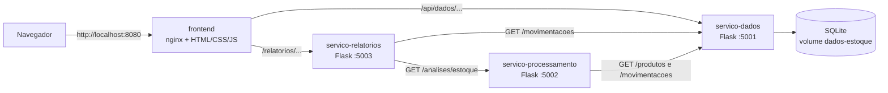

# Sistema de Controle e Análise de Estoque com Microsserviços

Projeto acadêmico da disciplina de **Arquitetura Orientada a Serviços (SOA)** ("Atividade para Nota 2").
Simula uma pequena loja que cadastra produtos, registra entradas e saídas de estoque, calcula o saldo
de cada produto e gera relatórios para apoiar a gestão. Todos os dados são **fictícios**: não há
integração com nenhuma loja real.

O objetivo não é um sistema comercial completo, e sim demonstrar, de forma funcional, separação de
responsabilidades, comunicação HTTP entre serviços, persistência de dados, processamento e geração de
relatórios, com cada serviço em seu próprio contêiner Docker.

## Arquitetura



| Serviço | Responsabilidade | Tecnologia | Porta |
|---|---|---|---|
| `servico-dados` | Persiste produtos e movimentações; expõe endpoints de leitura e escrita; valida os dados e impede saldo negativo. É o **único** que acessa o banco. | Python, Flask, SQLite | 5001 |
| `servico-processamento` | Consome o Serviço de Dados por HTTP e calcula saldos, estoque abaixo do mínimo, totais e indicadores. | Python, Flask, requests | 5002 (apenas rede interna) |
| `servico-relatorios` | Orquestra as chamadas aos outros dois serviços e consolida o relatório final em JSON ou CSV. | Python, Flask, requests | 5003 |
| `frontend` | Página web simples e proxy (nginx) para os serviços. | HTML, CSS, JavaScript, nginx | 8080 |

Os serviços se comunicam por **HTTP com JSON** pela rede interna do Docker Compose, usando o nome do
serviço como endereço (por exemplo, `http://servico-dados:5001`).

## Regras de negócio

- **Saldo** = soma das entradas − soma das saídas (calculado a partir das movimentações, nunca armazenado).
- Uma **saída que deixaria o saldo negativo é rejeitada** (HTTP 409). A checagem do saldo e a gravação
  acontecem na mesma transação (`BEGIN IMMEDIATE`), então saídas simultâneas não ultrapassam o saldo.
- Um produto está **abaixo do mínimo** quando o saldo é *estritamente menor* que o estoque mínimo.
- Validações: quantidade inteira maior que zero, tipo `entrada` ou `saida`, produto existente, preço maior ou igual a zero.

## Pré-requisitos

- **Docker Desktop** (no Windows 11, com o backend WSL 2) e Docker Compose.
- Um navegador.

Confira com:

```powershell
docker --version
docker compose version
```

## Como executar

Na pasta raiz do projeto (a que contém o `docker-compose.yml`):

```powershell
docker compose up --build
```

Na primeira vez as imagens são baixadas e construídas, o que pode levar alguns minutos. Quando os
serviços estiverem saudáveis, abra **http://localhost:8080** no navegador.

Em outro terminal, para ver o estado dos contêineres:

```powershell
docker compose ps
```

Para parar o sistema **mantendo os dados** (ficam no volume `dados-estoque`):

```powershell
docker compose down
```

Para parar **e apagar os dados**:

```powershell
docker compose down -v
```

Nas execuções seguintes, `docker compose up` é suficiente; o `--build` só é necessário quando o código mudar.

## Roteiro de demonstração

Pela página em http://localhost:8080:

1. Cadastre o produto **Teclado**, preço 89,90, estoque mínimo **10**.
2. Registre uma **entrada** de 30 unidades.
3. Registre uma **saída** de 8 unidades.
4. Veja o relatório: o saldo esperado é **22** e o produto **não** deve aparecer como abaixo do mínimo.
5. Tente uma **saída de 50** unidades: deve ser rejeitada, informando o saldo atual (22).
6. Use **Ver JSON** e **Baixar CSV** para consultar o relatório nos dois formatos.
7. Rode `docker compose down` e depois `docker compose up`: os registros devem continuar salvos.

## Usando a API diretamente

Além da porta 8080, o Compose publica a **5001** (Serviço de Dados) e a **5003** (Serviço de Relatórios)
no seu computador, para testes diretos. O Serviço de Processamento (5002) fica acessível apenas dentro da
rede do Docker.

Exemplo no PowerShell:

```powershell
$h = @{ "Content-Type" = "application/json" }

Invoke-RestMethod -Method Post -Uri http://localhost:5001/produtos -Headers $h `
  -Body '{"nome":"Teclado","preco":89.9,"estoque_minimo":10}'
Invoke-RestMethod -Method Post -Uri http://localhost:5001/movimentacoes -Headers $h `
  -Body '{"produto_id":1,"tipo":"entrada","quantidade":30}'
Invoke-RestMethod -Method Post -Uri http://localhost:5001/movimentacoes -Headers $h `
  -Body '{"produto_id":1,"tipo":"saida","quantidade":8}'

Invoke-RestMethod http://localhost:5003/relatorios/estoque | ConvertTo-Json -Depth 5
curl.exe -o relatorio.csv http://localhost:5003/relatorios/estoque.csv
```

### Endpoints

**Serviço de Dados (5001)**

| Método | Rota | Descrição |
|---|---|---|
| POST | `/produtos` | Cadastra produto (`nome`, `preco`, `estoque_minimo`) |
| GET | `/produtos` | Lista produtos |
| GET | `/produtos/<id>` | Consulta um produto |
| POST | `/movimentacoes` | Registra entrada ou saída (`produto_id`, `tipo`, `quantidade`) |
| GET | `/movimentacoes` | Lista o histórico (filtro opcional `?produto_id=`) |
| GET | `/health` | Verificação de saúde |

Códigos de resposta: `201` criado, `400` dados inválidos, `404` não encontrado, `409` saída que deixaria o saldo negativo.

**Serviço de Processamento (5002, interno)**

| Método | Rota | Descrição |
|---|---|---|
| GET | `/analises/estoque` | Saldos, situação de estoque e indicadores |
| GET | `/health` | Verificação de saúde |

**Serviço de Relatórios (5003)**

| Método | Rota | Descrição |
|---|---|---|
| GET | `/relatorios/estoque` | Relatório consolidado em JSON |
| GET | `/relatorios/estoque.csv` | Relatório em CSV |
| GET | `/health` | Verificação de saúde |

Se um serviço do qual outro depende estiver fora do ar, o chamador responde com `503` (indisponível),
`504` (tempo esgotado) ou `502` (resposta de erro do serviço chamado), sempre com uma mensagem em JSON.

O CSV usa `;` como separador, vírgula decimal e UTF-8 com BOM, para abrir corretamente no Excel em português.

## Estrutura do projeto

```
sistema-estoque/
├── docker-compose.yml
├── README.md
├── dados/                      # banco local (apenas ao rodar sem Docker)
├── frontend/
│   ├── Dockerfile
│   ├── nginx.conf
│   ├── index.html
│   ├── style.css
│   └── app.js
├── servico-dados/
│   ├── Dockerfile
│   ├── requirements.txt
│   ├── app.py
│   └── database.py
├── servico-processamento/
│   ├── Dockerfile
│   ├── requirements.txt
│   └── app.py
└── servico-relatorios/
    ├── Dockerfile
    ├── requirements.txt
    └── app.py
```

## Executando sem Docker (opcional, para desenvolvimento)

Requer Python 3.10 ou superior. Cada serviço roda em um terminal próprio, dentro da sua pasta. Exemplo
para o Serviço de Dados no PowerShell:

```powershell
cd servico-dados
python -m venv .venv
.venv\Scripts\Activate.ps1
pip install -r requirements.txt
python app.py
```

Repita para `servico-processamento` e `servico-relatorios`. Sem Docker, os serviços usam `localhost` como
padrão e o banco fica em `dados/estoque.db`. As variáveis de ambiente `DB_PATH`, `DADOS_URL` e
`PROCESSAMENTO_URL` permitem alterar o caminho do banco e os endereços entre os serviços. O frontend
depende do proxy nginx e, por isso, só funciona pelo Docker Compose.

## Decisões de projeto e limitações

- **Servidor de desenvolvimento do Flask:** adequado para a demonstração; em produção usaríamos um
  servidor WSGI como o gunicorn.
- **SQLite em volume nomeado do Docker:** evita problemas de trava de arquivo do SQLite em pastas do
  Windows montadas no contêiner. O SQLite admite um escritor por vez, suficiente para este cenário.
- **Healthchecks:** `depends_on` com `service_healthy` garante que cada serviço só inicie depois que os
  que ele consome estiverem respondendo.
- **Sem autenticação** e sem controle de usuários, por estarem fora do escopo.
- Dados fictícios, sem integração com sistemas reais.

## Autoria

Henrique Pedrosa Laiter 22008543
Maria Eduarda Reis Machado 22001129